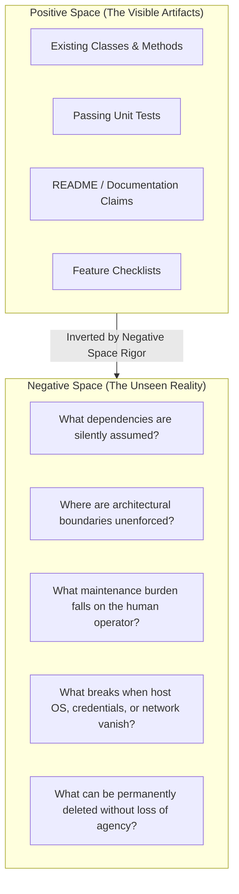
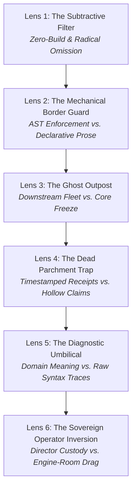
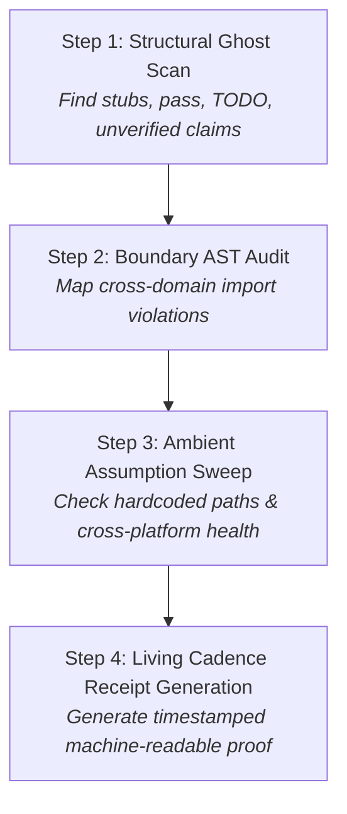
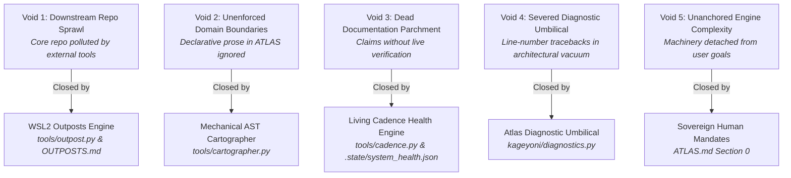

# Negative Space: Interrogation, Pushback & Discovery Protocol (`/negative-space`)

> *"The sculptor does not create the statue by adding clay; the sculptor reveals the form by carving away what does not belong. In software and systems architecture, true robustness is defined not by what you build, but by what you omit, what you isolate, and what you mechanically enforce."*

---

## Table of Contents

1. [The Core Philosophy (Positive Space Bias vs. Negative Space Rigor)](#1-the-core-philosophy)
   - 1.1 The Positive Space Cognitive Trap
   - 1.2 Negative Space Epistemology
   - 1.3 The Inversion Principle
   - 1.4 The Thermodynamic Cost of Code
2. [The 6 Diagnostic Lenses](#2-the-6-diagnostic-lenses)
   - 2.1 Lens 1: The Subtractive Filter (Zero-Build & Radical Omission)
   - 2.2 Lens 2: The Mechanical Border Guard (Declarative Rules vs. AST/Automated Enforcement)
   - 2.3 Lens 3: The Ghost Outpost (Air-Gapped / Downstream Fleet Disconnect)
   - 2.4 Lens 4: The Dead Parchment Trap (Claims without Timestamped Receipts)
   - 2.5 Lens 5: The Diagnostic Umbilical (Translating Raw Syntax to Domain Meaning)
   - 2.6 Lens 6: The Sovereign Operator Inversion ("I don't plan on using them myself")
3. [The 4 Mandatory Pushback Questions](#3-the-4-mandatory-pushback-questions)
   - 3.1 Q1: The Subtraction Question
   - 3.2 Q2: The Mechanical Boundary Question
   - 3.3 Q3: The Ambient Environment Question
   - 3.4 Q4: The Sovereign Custody Question
   - 3.5 The Pre-Flight Interrogation Gate
4. [Operational Workflows](#4-operational-workflows)
   - 4.1 Auditing a Repository for Negative Space Voids
   - 4.2 Interrogating a New Feature Request or Architecture Proposal
   - 4.3 Protecting the Human Director from Engine-Room Complexity ("The Push Right Law")
5. [Concrete Case Studies from the Kageyoni v11 Estate](#5-concrete-case-studies)
   - 5.1 Case Study 1: Cartographer Closing Void 2 (Boundary Enforcement)
   - 5.2 Case Study 2: Outposts Closing Void 1 (Downstream Sandboxing)
   - 5.3 Case Study 3: Cadence Closing Void 3 (Living Health Receipts)
   - 5.4 Case Study 4: Diagnostics Closing Void 4 (The Diagnostic Umbilical)
   - 5.5 Case Study 5: Sovereign Mandates Closing Void 5 (The Human Intent Anchor)
   - 5.6 Case Study 6: macOS Darwin Dual-Homing & Platform Bootstrap
6. [Quick Reference & Integration](#6-quick-reference--integration)

---

## 1. The Core Philosophy

### 1.1 The Positive Space Cognitive Trap

Language models, junior developers, and uncritical software architectures suffer from a fundamental cognitive distortion: **Positive Space Bias**.

Positive space bias is the overwhelming compulsion to:
- Evaluate systems solely by what exists on disk (the lines of code written, classes declared, files created).
- Solve friction by **adding** components (adding another layer of abstraction, another wrapper, another daemon, another configuration file).
- Equate code volume with progress, and test greenness with architectural health.
- Accept declarative claims at face value (reading a `README.md` that claims "Architecture is fully decoupled" and believing it without verification).

In positive space thinking, the system looks healthy as long as existing files compile and tests return exit code 0. But this is an illusion. Most software failures occur in the **Negative Space**—in what was *omitted*, what remained *unmapped*, what was *falsely assumed*, what had *no mechanical enforcement*, and what silently imposed *cognitive or maintenance debt* on the human operator.

### 1.2 Negative Space Epistemology

Negative Space thinking flips the focus of analysis:



Negative space rigor asks:
1. **The Omission Void**: What critical runtime conditions or recovery paths are absent?
2. **The Unenforced Boundary Void**: What is stopping Domain A from leaking into Domain B when a tired developer edits code late at night?
3. **The Ambient Assumption Void**: Does this code secretly assume a specific OS, a global package install, an active internet connection, or an unpinned local state?
4. **The False Attestation Void**: Is this documentation an accurate mirror of reality, or an aspirational ghost of an architecture that was never verified?
5. **The Sovereign Drain Void**: Does this feature serve the user's sovereign life priorities, or is it decorative complexity that creates maintenance fatigue?

### 1.3 The Inversion Principle

Whenever faced with a problem, architecture review, or feature request, **invert the inquiry**:
- Instead of asking: *"How do we build this feature?"*  
  Ask: *"What has to be true for this problem to disappear without building anything?"*
- Instead of asking: *"What tests do we write to prove this works?"*  
  Ask: *"What invalid inputs or malicious mutations will pass these tests without raising an alarm?"*
- Instead of asking: *"What documentation explains this architecture?"*  
  Ask: *"What automated machine gate prevents this architecture from rotting when documentation is ignored?"*
- Instead of asking: *"How can the user configure this?"*  
  Ask: *"Why is the user being forced to make decisions that the system should resolve autonomously?"*

### 1.4 The Thermodynamic Cost of Code

Every line of code added to a repository is a thermodynamic liability:
- It consumes reader attention.
- It introduces new combinatorial failure states.
- It requires ongoing maintenance across dependency updates, OS upgrades, and runtime evolutions.
- It widens the surface area for silent regressions.

Negative Space rigor demands that code must fight for its right to exist. The best code is the code you never wrote; the second best is the code you deleted; the third best is the isolated, zero-dependency, bounded mechanism that cannot leak beyond its perimeter.

---

## 2. The 6 Diagnostic Lenses

The Negative Space methodology uses six structured diagnostic lenses to interrogate systems, pull requests, and AI proposals:



---

### 2.1 Lens 1: The Subtractive Filter (Zero-Build & Radical Omission)

**Core Premise**: Before adding a single class, package, or configuration flag, explore radical subtraction.

* **The Anti-Pattern**: An AI or developer receives a prompt like *"We need caching for our API calls"* and immediately writes a Redis adapter, a cache invalidation engine, docker-compose files, and configuration schemas.
* **The Negative Space Interrogation**:
  - Do we actually need caching, or is the upstream query doing 10 unnecessary table scans?
  - Can we memoize 20 keys in an in-memory `dict`?
  - Can we eliminate the need for the query entirely by passing the state in the caller's context?
  - What breaks if we build *nothing*?
* **Actionable Rule**: Every architectural proposal must evaluate the **Zero-Build Option**:
  1. *Option 1 (Subtraction)*: Solve by deleting dead code, reusing an existing CLI flag, or tightening an invariant.
  2. *Option 2 (Lightweight Mechanism)*: Single-file surgical hook (~50 LOC), zero external dependencies.
  3. *Option 3 (Full System)*: Multi-component architecture—only accepted if Subtraction and Lightweight prove mathematically insufficient.

---

### 2.2 Lens 2: The Mechanical Border Guard (Declarative Rules vs. AST/Automated Enforcement)

**Core Premise**: A rule that is only written in markdown is not a rule; it is a wish.

* **The Anti-Pattern**: An architecture document states: *"Domain 1 (Core Causal Engine) must never depend on Domain 3 (Tactical Combat Engine)."* Months later, a developer imports `kageyoni.combat.resolver` into `kageyoni.engine` to calculate an attack roll. The test suite passes. The architecture is broken, but no alarm fires.
* **The Negative Space Interrogation**:
  - What mechanically prevents this rule from being broken?
  - Is there an automated AST validator (`cartographer.py`, `code_graph.py`) running in CI that inspects every `ast.Import` and `ast.ImportFrom` and exits with code 1 upon violation?
  - Does the enforcement run locally without network or LLM quota?
* **Actionable Rule**: **Zero-Trust Boundary Rule**. Never accept an architectural boundary claim unless accompanied by an automated, AST-level or test-level mechanical gate that verifies the boundary in cold process execution.

---

### 2.3 Lens 3: The Ghost Outpost (Air-Gapped / Downstream Fleet Disconnect)

**Core Premise**: Protect the Mother Ship core by establishing air-gapped downstream outposts for volatile, external, or exploratory workloads.

* **The Anti-Pattern**: A developer wants to build a web scraper for job boards or a binary reverse engineering probe. They start adding `beautifulsoup4`, `playwright`, `scikit-learn`, or `ghidra-bridge` to the root `pyproject.toml` or `requirements.txt`. Within weeks, the core causal engine cannot run on macOS or standard Python because of broken compiled C extensions and version conflicts.
* **The Negative Space Interrogation**:
  - Why is this exploratory or downstream utility touching the repository root?
  - What prevents this dependency sprawl from polluting the core LTS runtime?
  - Can this run in an isolated sandbox (e.g. WSL2 Ubuntu outpost, dedicated virtualenv) with an air-gapped lifecycle?
* **Actionable Rule**: **The Outpost Boundary Invariant**.
  - Core engine repositories (`c:\Kageyoni`) remain frozen, minimal, and zero-pip.
  - All experimental tools, scraping jobs, and micro-applications must live in downstream outposts (e.g. `/home/flowe/outposts/<name>`) with their own `.venv`, their own `runner.py`, and independent git histories.
  - Communication across the seam happens via bounded JSON artifacts, never shared in-memory state or polluted package manifests.

---

### 2.4 Lens 4: The Dead Parchment Trap (Claims without Timestamped Receipts)

**Core Premise**: Treat all documentation, status reports, and verbal success claims as unverified rumors until grounded by timestamped, cryptographic machine receipts.

* **The Anti-Pattern**: A README declares: *"All 24 database migrations pass cleanly. Test coverage is 98%."* When tested on a fresh machine, migration 18 fails because of a missing SQLite column, and tests haven't been run since three commits ago.
* **The Negative Space Interrogation**:
  - When was this last verified?
  - Under what git commit hash?
  - What was the exact exit code and stderr of the process?
  - Is there a machine-readable health receipt (`.state/system_health.json`) that can be programmatically audited by downstream tools?
* **Actionable Rule**: **The Receipt Invariant**.
  - Invalidate all claims that lack an empirical artifact.
  - Implement a living cadence engine (`tools/cadence.py`) that captures the exact commit hash, timestamp, migration count, test pass/fail counts, and outpost fleet statuses into an authoritative JSON receipt.

---

### 2.5 Lens 5: The Diagnostic Umbilical (Translating Raw Syntax to Domain Meaning)

**Core Premise**: A raw Python or system traceback operates in an architectural vacuum; diagnostics must bridge physical line numbers back to sovereign domain meaning.

* **The Anti-Pattern**: A production service crashes with:
  ```text
  KeyError: 'entity_984'
    at kageyoni/engine.py:142 in apply
  ```
  The developer has no idea what happened. Was this a tactical combat state error? A narrative continuity violation? A missing database migration? A rogue agent?
* **The Negative Space Interrogation**:
  - What architectural domain does this file belong to?
  - What invariant was breached?
  - What were the caller and callee domains? Did a cross-boundary import cause invalid state injection?
  - How do we give the human operator immediate architectural situational awareness instead of forcing them to reverse-engineer line numbers?
* **Actionable Rule**: **Domain-Aware Diagnostic Wrappers**.
  - All critical entry points must use diagnostic umbilicals (`kageyoni/diagnostics.py`) that map file paths and stack frames to their Sovereign Domain ID, Domain Name, and Invariant Boundary Policy.
  - Stack traces must output domain context alongside physical line numbers (e.g., `[DOMAIN 01: Core Kernel] -> Violation: Zero Direct SQLite Mutation`).

---

### 2.6 Lens 6: The Sovereign Operator Inversion ("I don't plan on using them myself")

**Core Premise**: The human creator is the Sovereign Director, not an engine-room grease monkey. Code must minimize user friction, not offload complexity onto the operator.

* **The Anti-Pattern**: An AI agent finishes a task and tells the user:
  *"I've implemented the database synchronizer! To use it, simply run `python sync.py --db-host 127.0.0.1 --port 5432 --token <token> --batch-size 500 --retry-limit 3 --schema-v2`. If you see an SSL error, make sure to configure your OpenSSL cert path in your shell profile."*
  This is a failure of custody. The agent built machinery that demands the user become its operator.
* **The Negative Space Interrogation**:
  - Why is the system demanding the user memorize flags and environment variables?
  - Why doesn't a single zero-argument command (`python -m tools.runner sync` or `python -m tools.runner cadence`) handle detection, configuration, and execution autonomously?
  - How do we keep the human at the level of sovereign intent ($85K+ career radar, A/V creative direction, personal knowledge sovereignty) rather than syntax mechanics?
* **Actionable Rule**: **The Sovereign Inversion Mandate**.
  - Provide unified, self-discovering single-gate entry points (`tools/runner.py`, `bootstrap.py`).
  - Provide sensible defaults for everything.
  - Enforce the "Push Right" law: Defer human interaction to the finish line. Run research, code, tests, and audits autonomously, surfacing one decision-ready brief with clear recommendations.

---

## 3. The 4 Mandatory Pushback Questions

Every autonomous agent, code reviewer, and system architect operating under `/negative-space` **MUST** ask and answer these four pushback questions before accepting a design or claiming a task is Done:

```markdown
┌─────────────────────────────────────────────────────────────────────────────┐
│                       THE 4 PUSHBACK QUESTIONS                              │
├─────────────────────────────────────────────────────────────────────────────┤
│ 1. THE SUBTRACTION QUESTION:                                                │
│    "What can we delete or avoid building altogether, and what breaks if we   │
│     do nothing?"                                                            │
│                                                                             │
│ 2. THE MECHANICAL BOUNDARY QUESTION:                                        │
│    "Is this invariant enforced by an automated machine check (AST/test gate)│
│     or does it rely on human/agent good behavior?"                          │
│                                                                             │
│ 3. THE AMBIENT ENVIRONMENT QUESTION:                                        │
│    "What hidden assumptions exist about host OS, paths, credentials, and    │
│     dependencies, and can a fresh clone boot in 3 commands without pip      │
│     pollution?"                                                             │
│                                                                             │
│ 4. THE SOVEREIGN CUSTODY QUESTION:                                          │
│    "Does this reduce cognitive friction and advance the human's sovereign   │
│     mandates, or does it dump engine-room maintenance and verification      │
│     fatigue onto the operator?"                                             │
└─────────────────────────────────────────────────────────────────────────────┘
```

### 3.1 Q1: The Subtraction Question
- **Probe**: Identify decorative architecture, speculative features ("we might need this later"), and unnecessary dependencies.
- **Fail Condition**: If the proposed feature can be replaced by deleting dead code or passing an existing variable, **reject the proposal**.

### 3.2 Q2: The Mechanical Boundary Question
- **Probe**: Search for declarative promises in markdown that lack an accompanying test or AST verification script.
- **Fail Condition**: If an architectural boundary (e.g., Domain A cannot import Domain B) relies solely on developer discipline without a gate like `cartographer.py`, **reject the plan until a mechanical gate is included**.

### 3.3 Q3: The Ambient Environment Question
- **Probe**: Audit for hardcoded Windows drive letters (`C:\`), hardcoded POSIX paths (`/home/user/`), unpinned network requests, global `pip install` requirements, or host-specific binaries.
- **Fail Condition**: If the code fails to run on macOS Darwin or fresh Linux without manual environment hacking, **reject the implementation**.

### 3.4 Q4: The Sovereign Custody Question
- **Probe**: Evaluate who carries the thermodynamic burden of this change. Does the user have to remember new flags, troubleshoot obscure errors, or run multi-step setups?
- **Fail Condition**: If the system outputs raw tracebacks or demands manual babysitting instead of autonomous resolution, **refuse completion until wrapped in single-gate tooling**.

---

## 4. Operational Workflows

### 4.1 Auditing a Repository for Negative Space Voids

To perform a Negative Space audit of an existing codebase:



1. **Step 1: Structural Ghost Scan**:
   - Run AST analysis or regex to find hollow stubs (`pass`, `TODO`, `NotImplementedError`) in supposedly completed modules.
   - Separate **Wired Code** (imported and executed by active callers) from **Dead Weight Code** (unreferenced files cluttering the repository).
2. **Step 2: Boundary AST Audit**:
   - Parse all Python source files via `ast.parse`.
   - Extract all import targets (`Import`, `ImportFrom`).
   - Compare observed imports against the architectural domain fence matrix (e.g. Domain 1 $\to$ Domain 3 forbidden).
3. **Step 3: Ambient Assumption Sweep**:
   - Search for hardcoded drive letters (`C:`, `D:`) or hardcoded home directories (`/home/flowe`).
   - Check if dynamic relative path resolution (`Path(__file__).resolve().parent`) is implemented everywhere.
   - Verify that core library imports rely strictly on Python standard library modules (zero-pip core).
4. **Step 4: Living Cadence Receipt Generation**:
   - Execute cold-process smoke tests and migration verification.
   - Emit an authoritative JSON receipt (`.state/system_health.json`) capturing commit hash, timestamp, test results, and fleet status.

---

### 4.2 Interrogating a New Feature Request or Architecture Proposal

When the user or an agent presents an idea, run the **3-Representation Interrogation Matrix**:

| Representation | Core Mechanism | What Gets Deleted / Avoided | Failure Mode & Cost |
| :--- | :--- | :--- | :--- |
| **1. Zero-Build / Subtraction** | Solve by deleting dead abstractions, tightening an invariant rule, or reusing existing flags. | Zero new lines of code; removes existing debt and mental load. | Hits a ceiling if new runtime state persistence is strictly required. |
| **2. Lightweight Mechanism** | Single-file hook, AST query, or SQLite table (~50–150 LOC) wired into existing runner. | Avoids daemon servers, background threads, external packages, or multi-repo overhead. | Limited to single-host synchronous execution. |
| **3. Full System** | Multi-component architecture, isolated worker pool, or persistent state machine. | Avoids ad-hoc patches; provides total sandboxing and auditability. | Highest maintenance surface, integration latency, and testing burden. |

Present these trade-offs clearly to the user, highlighting the recommended subtractive path first.

---

### 4.3 Protecting the Human Director from Engine-Room Complexity ("The Push Right Law")

The **Push Right Law** states: *Defer human interaction to the far right. Autonomously execute research, implementation, testing, and adversarial reviews before surfacing a single decision-ready brief.*

1. **Default-Yes Frontier Grilling**:
   - When architectural decisions must be made, never ask open-ended questions like *"How do you want to handle errors?"*
   - Instead, compute the active decision frontier, batch the settled prerequisites, and state:
     ```markdown
     ❓ Q1 - Error Strategy: Fall back to in-memory SQLite cache when network is offline. 
        ➡️ Recommended: Yes
     ```
   - Word recommendations so the operator can type `"yes"` to accept.
2. **3-Strike Autonomous Governor**:
   - If an automated test or gate fails, the agent must diagnose, form a hypothesis, and attempt repair autonomously up to 3 times.
   - Only after 3 distinct failed repairs does the agent pause to deliver a Root Cause Architecture Assessment.
3. **Single-Gate Facade**:
   - Wrap internal script sprawl behind unified tool dispatchers:
     ```bash
     python -m tools.runner <command>
     ```
   - Never force the user to hunt for individual scripts scattered across subdirectories.

---

## 5. Concrete Case Studies from the Kageyoni v11 Estate

The Kageyoni v11 computational estate serves as the canonical real-world proof of Negative Space engineering. Five major voids were systematically identified, interrogated, and permanently closed:



---

### 5.1 Case Study 1: Cartographer Closing Void 2 (Boundary Enforcement)

* **The Negative Space Void**:
  `ATLAS.md` clearly defined the 6 Sovereign Domains of Kageyoni. It prohibited Domain 1 (Causal Engine Kernel) from importing Domain 3 (Tactical Combat & Playable World). However, this prohibition was purely declarative text. A rogue subagent or hurried commit could easily import `kageyoni.combat` into `kageyoni.engine`, introducing subtle circular dependencies and breaking the kernel.
* **The Negative Space Solution**:
  The creation of [`tools/cartographer.py`](file:///C:/Kageyoni/tools/cartographer.py). This tool parses the Python AST across the entire repository without executing code or consuming LLM quota. It verifies that:
  - Domain 1 files never import from `kageyoni.combat`, `kageyoni.playable_world`, `kageyoni.martial`, `kageyoni.spatial`, or `kageyoni.cli`.
  - Violations immediately exit with code 1 and display exact line numbers and symbol names.
* **Result**:
  Boundary compliance transformed from an aspirational wish into a deterministic, mechanically enforced reality.

---

### 5.2 Case Study 2: Outposts Closing Void 1 (Downstream Sandboxing)

* **The Negative Space Void**:
  The user needed operational micro-applications: a CAD job-hunting radar (`job-radar`) scraping external boards and testing resumes, and diagnostic telemetry probes (`sample-probe`). Adding scraping dependencies, headless browsers, and external API libraries into `c:\Kageyoni` threatened to destabilize the frozen v11.0 LTS core causal engine.
* **The Negative Space Solution**:
  The **Outpost Architecture** ([`OUTPOSTS.md`](file:///C:/Kageyoni/OUTPOSTS.md) and [`tools/outpost.py`](file:///C:/Kageyoni/tools/outpost.py)). Downstream systems were banished from the core source tree and instantiated in isolated WSL2 Ubuntu environments (`/home/flowe/outposts/<name>`) with:
  - Independent Linux `.venv` virtual environments.
  - Dedicated `runner.py` with standard `test`, `run`, and `status` verbs.
  - Windows host control via UNC paths (`\\wsl$\Ubuntu\home\flowe\outposts\<name>`) and `python -m tools.runner outpost <command>`.
* **Result**:
  The core causal engine remains 100% frozen and clean, while downstream development proceeds with full Linux agility.

---

### 5.3 Case Study 3: Cadence Closing Void 3 (Living Health Receipts)

* **The Negative Space Void**:
  Release documents and readmes routinely claim "system is stable" or "all 24 migrations passed". Over time, code evolves, migrations accumulate, and documentation becomes "dead parchment"—an unverified historical artifact.
* **The Negative Space Solution**:
  The **Living Cadence Engine** ([`tools/cadence.py`](file:///C:/Kageyoni/tools/cadence.py)). It inspects git HEAD, checks the 24 numbered database migrations, audits outpost fleet health, executes core dual-runner smoke tests, and serializes a tamper-evident receipt to `.state/system_health.json`:
  ```json
  {
    "timestamp_utc": "2026-10-27T04:45:00Z",
    "git": { "commit_hash": "bc04463...", "branch": "main" },
    "database": { "migration_count": 24, "status": "VERIFIED" },
    "test_suite": { "exit_code": 0, "status": "PASSED" },
    "outposts": { "total_registered": 2, "healthy": 2 }
  }
  ```
* **Result**:
  Health is no longer asserted through persuasive prose; it is proven through executable, timestamped receipts.

---

### 5.4 Case Study 4: Diagnostics Closing Void 4 (The Diagnostic Umbilical)

* **The Negative Space Void**:
  When an exception occurred deep in the causal engine, standard tracebacks dumped naked file paths and line numbers:
  `File "kageyoni/engine.py", line 140, in apply`.
  This gave zero indication of which Sovereign Domain had failed, what invariant was breached, or what caller domain had originated the bad payload.
* **The Negative Space Solution**:
  The **Atlas Diagnostic Umbilical** ([`kageyoni/diagnostics.py`](file:///C:/Kageyoni/kageyoni/diagnostics.py)). It intercepts errors and maps the stack frame back into Kageyoni's 6 Sovereign Domains:
  - Identifies source domain, target domain, and domain boundary policies.
  - Identifies which canonical invariants (e.g., *Zero Direct SQLite Mutation*, *Fail-Closed Compilation*) were endangered.
  - Formats architectural diagnostics that give the operator instant context without manual source tracing.
* **Result**:
  Raw mechanical crashes are instantly translated into actionable architectural meaning.

---

### 5.5 Case Study 5: Sovereign Mandates Closing Void 5 (The Human Intent Anchor)

* **The Negative Space Void**:
  Complex codebases often succumb to "architecture for architecture's sake." Highly sophisticated state machines, AST compilers, and mathematical engines get built, but have no connection to the real-world goals of the human creator.
* **The Negative Space Solution**:
  The formalization of **Sovereign Human Mandates** in Section 0 of [`ATLAS.md`](file:///C:/Kageyoni/ATLAS.md). Every subsystem in Kageyoni is explicitly chartered to serve one of three authentic human priorities:
  1. *Mandate 01: Career Sovereignty*: Securing engineering roles meeting the **$85K+ CAD compensation floor** via `outposts/job-radar`, `cl-craft`, and `cl-review`.
  2. *Mandate 02: Media Velocity*: Independent filmmaking and video essay production via `visual-asset-craft`, `av-scriptwriting`, and the 4-Point Visual Gate.
  3. *Mandate 03: Personal Sovereignty*: Cognitive OS knowledge vault, 3-Tier Reversibility Matrix, and thermodynamic cognitive protection.
* **Result**:
  Any feature, refactor, or optimization that does not directly advance one of these three mandates is recognized as decorative waste and pruned.

---

### 5.6 Case Study 6: macOS Darwin Dual-Homing & Platform Bootstrap

* **The Negative Space Void**:
  Software built primarily on Windows often harbors insidious, unstated assumptions: hardcoded backslashes (`\`), drive letters (`C:\`), dependency on WSL2, or reliance on globally installed packages. When cloned onto a developer's MacBook (macOS Darwin), the system immediately breaks.
* **The Negative Space Solution**:
  1. **Dynamic Relative Path Resolution**: All paths derived dynamically via `Path(__file__).resolve().parent.parent`.
  2. **Zero-Pip Core**: The entire Kageyōni causal engine, 48-channel Ninshū desk, and emergence layers execute using **pure Python 3.10+ standard library**—zero `pip install` required.
  3. **Platform Bootstrap & Dual-Homing** ([`tools/bootstrap.py`](file:///C:/Kageyoni/tools/bootstrap.py), [`platform-bootstrap`](file:///c:/Kageyoni/.agents/skills/platform-bootstrap/SKILL.md)): Auto-detects macOS vs. Windows/WSL2; transparently switches outpost storage to native POSIX `$HOME/outposts/` on Darwin while maintaining UNC pathing on Windows.
* **Result**:
  A developer on macOS can clone the repository and achieve full operational verification in three commands:
  ```bash
  git clone https://github.com/guarani-ux/Kageyoni.git && cd Kageyoni
  python3 -m tools.runner cadence
  python3 -m tools.runner outpost list
  ```

---

## 6. Quick Reference & Integration

### The Negative Space Interrogation Checklist

Before marking any task Done or submitting an implementation plan, run this checklist:

```markdown
- [ ] Subtractive Check: Did we consider solving this by deletion or zero-build?
- [ ] Boundary Check: Is there an automated AST/test gate enforcing this boundary?
- [ ] Outpost Check: Is volatile/downstream code isolated from the frozen core?
- [ ] Receipt Check: Is there a timestamped machine receipt proving this works?
- [ ] Umbilical Check: Are error messages domain-aware rather than raw syntax dumps?
- [ ] Operator Check: Can this be run via a single-gate runner without manual friction?
- [ ] Platform Check: Does this run cleanly on both Windows and macOS Darwin without pip bloat?
- [ ] Sovereign Check: Does this directly serve one of the human's real-world mandates?
```

### Related Skills and Tools in the Estate

- [`mode-reframe`](file:///C:/Users/flowe/.gemini/config/skills/mode-reframe/SKILL.md): Mode 1 discovery and 3-representation matrix.
- [`mode-forensic`](file:///C:/Users/flowe/.gemini/config/skills/mode-forensic/SKILL.md): Cold-start AST audit of unfamiliar repositories.
- [`grilling`](file:///C:/Users/flowe/.gemini/config/skills/grilling/SKILL.md): Relentless stress-testing of assumptions and plans.
- [`council-reversibility-agent`](file:///C:/Users/flowe/.gemini/config/skills/council-reversibility-agent/SKILL.md): 3-Tier Reversibility Matrix enforcement.
- [`outpost-workflow`](file:///c:/Kageyoni/.agents/skills/outpost-workflow/SKILL.md): Isolated downstream WSL2/POSIX sandbox management.
- [`platform-bootstrap`](file:///c:/Kageyoni/.agents/skills/platform-bootstrap/SKILL.md): Automated dual-homing platform setup and verification.
- [`tools/runner.py`](file:///C:/Kageyoni/tools/runner.py): Master unified CLI entrypoint for all estate tools.
- [`tools/cartographer.py`](file:///C:/Kageyoni/tools/cartographer.py): Mechanical AST sovereign domain boundary guard.
- [`tools/cadence.py`](file:///C:/Kageyoni/tools/cadence.py): Living cadence and system health receipt engine.
- [`kageyoni/diagnostics.py`](file:///C:/Kageyoni/kageyoni/diagnostics.py): Atlas diagnostic umbilical and architectural trace resolver.
