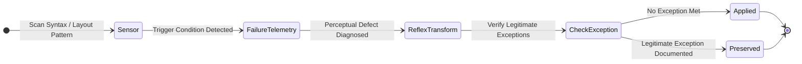

# Visual Reflex — Anti-Slop Physical Engineering Engine

Visual Reflex is a deterministic, closed-loop state machine for UI, visual layout, and interface styling. It replaces passive checklists and AI design habits with **four physical invariants**: Light & Dynamic Range, Spatial Tension & Density, Typographic Rag & Mass, and Kinetic Mass & Inertia.

Every entry in this engine operates as an active **Sensor ➔ Telemetry ➔ Transform ➔ Exception** reflex quad. When a trigger condition appears in CSS, HTML, or Tailwind markup, the corresponding transform executes automatically.

---

## The Reflex State Machine Triad



---

## Family 1: Light & Dynamic Range (Photometric Invariants)

### Reflex 1.1: Harsh Digital Clipping (#000000 / #FFFFFF Hard Cuts)

*   **Sensor / Trigger Condition:**
    *   `#000000`, `#ffffff`, `bg-black`, `bg-white` applied as primary container backgrounds without dynamic range roll-off.
    *   `text-white` rendered directly over raw `bg-black` without intermediary luminance staging.
*   **Failure Telemetry:**
    *   *Optical Clipping & Eye Fatigue.* Pure digital #000 destroys ambient roll-off and creates an artificial, dead black hole on OLED displays. Pure #FFF text on #000 causes optical halation and high-contrast fringe blurring around letterforms.
*   **Reflex Transform:**
    *   Tone-map the darks to a 95% ceiling (`#09090b`, `#0d0f12`, `bg-zinc-950`) and soften primary highlights to a 96% floor (`#f4f4f5`, `#e4e4e7`, `text-zinc-100`).
    ```html
    <!-- BEFORE (Digital Slop): Raw digital clip -->
    <div class="bg-black text-white p-6">
      <h2 class="text-xl">System Status</h2>
    </div>

    <!-- AFTER (Reflex Transform): Luminance staged with roll-off -->
    <div class="bg-zinc-950 text-zinc-100 border border-zinc-800/80 p-6">
      <h2 class="text-xl font-semibold text-zinc-50 tracking-tight">System Status</h2>
      <p class="text-sm text-zinc-400 mt-1">Operational nodes verified.</p>
    </div>
    ```
*   **Legitimate Exceptions:**
    *   `prefers-contrast: more` high-contrast accessibility modes.
    *   Explicit 1-bit terminal emulators or retro monochrome CRT aesthetics.
    *   Print-targeted media styles (`@media print`) requiring pure paper white and K100 black.

---

### Reflex 1.2: One-Shot Muddy Drop Shadows (Single Blur Card Slop)

*   **Sensor / Trigger Condition:**
    *   Single-layer box shadows: `box-shadow: 0 4px 6px rgba(0,0,0,0.1)`, `shadow-md`, `shadow-lg` without contact occlusion.
*   **Failure Telemetry:**
    *   *Detached Plane Floating (The "Hovering Sheet" Fallacy).* Single large-radius shadows create a murky gray aura around elements. They lack the tight contact shadow where an object meets its surface, causing cards to feel detached from physical space.
*   **Reflex Transform:**
    *   Implement **2-stage contact occlusion**: a razor-thin, higher-opacity contact edge (0–1px) paired with an expansive, low-opacity ambient scatter (8–24px).
    ```css
    /* Contact Occlusion Two-Stage Elevation */
    .surface-elevated {
      box-shadow:
        0 1px 2px rgba(0, 0, 0, 0.35),   /* Stage 1: Tight contact occlusion */
        0 8px 24px -4px rgba(0, 0, 0, 0.18); /* Stage 2: Diffused ambient falloff */
    }
    ```
    ```html
    <!-- Tailwind Arbitrary Utility -->
    <div class="bg-zinc-900 border border-zinc-800/80 rounded-xl shadow-[0_1px_2px_rgba(0,0,0,0.4),0_12px_28px_-6px_rgba(0,0,0,0.25)] p-5">
      <span class="text-xs font-mono text-zinc-400">ACTIVE MATRIX</span>
    </div>
    ```
*   **Legitimate Exceptions:**
    *   Flat design languages that rely strictly on high-contrast 1px hairline borders (`border border-zinc-800`).
    *   Hard neo-brutalist solid offsets (`shadow-[4px_4px_0px_#000000]`).
    *   Deep background layers where ambient illumination is below visible detection thresholds.

---

### Reflex 1.3: Dead Achromatic Grey (Zombie Dark Mode)

*   **Sensor / Trigger Condition:**
    *   Neutral gray palettes (`#71717a`, `#6b7280`, `bg-gray-900`, `border-gray-700`) applied across colored interactive dashboards without temperature bias.
*   **Failure Telemetry:**
    *   *Cognitive Desaturation Deadness.* Pure desaturated grays feel sterile and industrial. Real-world dark environments inherit the color temperature of their primary light source.
*   **Reflex Transform:**
    *   Inject 2–4% chromatic bias matching the core brand temperature (cool slate/cyan for technical instruments, warm obsidian/amber for operational consoles).
    ```css
    :root {
      /* Cool Instrumental Dark (Slate Biased) */
      --surface-base: #0b0f17;
      --surface-card: #111827;
      --surface-border: rgba(56, 189, 248, 0.12);

      /* Warm Console Dark (Amber/Zinc Biased) */
      --surface-warm-base: #0c0a09;
      --surface-warm-card: #1c1917;
      --surface-warm-border: rgba(245, 158, 11, 0.14);
    }
    ```
    ```html
    <!-- Biased Tailwind Surface -->
    <div class="bg-slate-950 border border-sky-950/60 rounded-xl p-5 text-slate-200">
      <div class="text-xs font-mono text-sky-400">TELEMETRY BUS</div>
    </div>
    ```
*   **Legitimate Exceptions:**
    *   Color grading suites, medical imaging monitors, and image inspection tooling where D65 neutral gray is required to prevent perceptual chroma contamination.

---

### Reflex 1.4: Blinding Unconstrained Glowing Borders (Neon Slop)

*   **Sensor / Trigger Condition:**
    *   `box-shadow: 0 0 20px #3b82f6`, `shadow-cyan-500/80`, over-saturated neon borders on dark containers.
*   **Failure Telemetry:**
    *   *Contrast Blowout & Low-Fi AI Tell.* Heavy outer glows bleed into surrounding typography, obliterate component hierarchy, and emulate generic "crypto landing page" templates.
*   **Reflex Transform:**
    *   Subsurface highlight edge: Restrain the glow to a sharp 1px top highlight (simulating overhead light hitting a beveled edge) combined with a muted 8px falloff at 15–20% opacity.
    ```html
    <!-- Reflex Transform: Beveled top highlight with subtle rim illumination -->
    <div class="relative bg-zinc-900/90 border border-zinc-800 rounded-xl p-6 overflow-hidden">
      <!-- Razor top light-shelf -->
      <div class="absolute inset-x-0 top-0 h-px bg-gradient-to-r from-transparent via-cyan-500/50 to-transparent"></div>
      <h3 class="text-base font-semibold text-zinc-100">Causal Engine</h3>
    </div>
    ```
*   **Legitimate Exceptions:**
    *   Active execution status indicators (flashing red error beacons, active recording tally lights).
    *   Audio VU meter peak overloads.

---

## Family 2: Spatial Tension & Density (Architectural Layout)

### Reflex 2.1: Nested Cardception (Card Inside a Card Inside a Card)

*   **Sensor / Trigger Condition:**
    *   `.card .card` or `div.rounded-lg.bg-zinc-800` nested inside `div.rounded-xl.bg-zinc-900` nested inside `div.bg-zinc-950`.
*   **Failure Telemetry:**
    *   *Visual Claustrophobia & Padding Inflation.* Every nested card consumes 16–24px of horizontal space in margins and padding, crushing the actual data payload into a narrow, suffocated box.
*   **Reflex Transform:**
    *   Strip inner card backgrounds. Replace them with **Hairline Partition Syntax**: exposed 1px dividers (`divide-y divide-zinc-800/60`), subtle background zebra striping, or asymmetric negative space.
    ```html
    <!-- BEFORE (Cardception Slop): Three nested containers -->
    <div class="bg-zinc-950 p-6 rounded-2xl">
      <div class="bg-zinc-900 p-4 rounded-xl">
        <div class="bg-zinc-800 p-3 rounded-lg">Metric 01: 94.2%</div>
      </div>
    </div>

    <!-- AFTER (Hairline Partitions): Clean structural datum -->
    <div class="bg-zinc-950 border border-zinc-800/80 rounded-xl p-5">
      <h3 class="text-xs font-mono uppercase tracking-wider text-zinc-400 mb-4">Operational Metrics</h3>
      <div class="divide-y divide-zinc-800/60">
        <div class="py-3 flex items-center justify-between">
          <span class="text-sm text-zinc-300">Throughput</span>
          <span class="text-sm font-mono text-zinc-100 tabular-nums">1,420 req/s</span>
        </div>
        <div class="py-3 flex items-center justify-between">
          <span class="text-sm text-zinc-300">Error Surface</span>
          <span class="text-sm font-mono text-emerald-400 tabular-nums">0.002%</span>
        </div>
      </div>
    </div>
    ```
*   **Legitimate Exceptions:**
    *   Draggable card lists (Kanban boards) where individual cards require distinct physical boundaries.
    *   Sandboxed iframe / playground previews embedded inside editor settings.

---

### Reflex 2.2: Uniform Robot Spacing (Monotonous Pad-and-Gap Slop)

*   **Sensor / Trigger Condition:**
    *   `p-6 gap-6 mb-6` applied to all hierarchy levels; uniform margins between headings, paragraphs, labels, and form controls.
*   **Failure Telemetry:**
    *   *Perceptual Flatline.* When every element has identical spacing, the human eye cannot determine grouping or hierarchy. Labels float ambiguously between inputs, destroying cognitive chunking.
*   **Reflex Transform:**
    *   **Proximity Binding Law:** Spacing must be inversely proportional to semantic relationship.
        *   Label-to-input: `gap-1.5` or `mb-1.5` (intimate proximity).
        *   Paragraph-to-subheading: `mt-2 mb-4` (medium proximity).
        *   Section-to-section: `mt-10 mb-6` (structural separation).
        *   Container padding: Asymmetric vertical breathing (`px-6 py-4` or `px-5 py-6`).
    ```html
    <!-- Reflex Transform: Semantic proximity hierarchy -->
    <div class="bg-zinc-950 border border-zinc-800 rounded-xl px-6 py-5">
      <div class="space-y-1.5">
        <label class="text-xs font-mono font-medium text-zinc-300">AUTHORITY BOUNDARY</label>
        <p class="text-xs text-zinc-500">Tier-1 destructive gate protection level.</p>
      </div>
      <div class="mt-4">
        <input type="text" class="w-full bg-zinc-900 border border-zinc-700/80 rounded-lg px-3 py-2 text-sm text-zinc-100 focus:outline-none focus:border-zinc-500" value="Strict Autonomous" />
      </div>
      <div class="mt-8 pt-4 border-t border-zinc-800/80 flex justify-end gap-3">
        <button class="px-3 py-1.5 text-xs text-zinc-400 hover:text-zinc-200">Revert</button>
        <button class="px-4 py-1.5 text-xs bg-zinc-100 hover:bg-white text-zinc-950 font-medium rounded-md">Save Changes</button>
      </div>
    </div>
    ```
*   **Legitimate Exceptions:**
    *   Data grids and spreadsheets where uniform row heights and column widths are functionally required.
    *   Matrix pads, calculator keys, and thumbnail image galleries.

---

### Reflex 2.3: Centered Cowardice (Center-Aligned Everything)

*   **Sensor / Trigger Condition:**
    *   `text-center items-center justify-center` applied indiscriminately to technical feature lists, multi-line documentation, dashboards, or forms.
*   **Failure Telemetry:**
    *   *Eye Navigation Fatigue.* Centered multi-line text forces the reader's eye to hunt for the starting point of every line, destroying reading velocity and creating messy ragged boundaries on both left and right edges.
*   **Reflex Transform:**
    *   Anchor to a **Hard Structural Left Datum**. Left-align headlines, descriptions, and lists; right-align telemetry values and actions to create dynamic tension across the horizontal axis.
    ```html
    <!-- Reflex Transform: Hard Left Spine with Right-Aligned Telemetry -->
    <div class="flex flex-col md:flex-row md:items-baseline md:justify-between border-b border-zinc-800 pb-4">
      <div class="max-w-md">
        <h2 class="text-lg font-semibold text-zinc-100 tracking-tight">Execution Receipts</h2>
        <p class="text-sm text-zinc-400 mt-1">Immutable cryptographic proof logs generated across active subagents.</p>
      </div>
      <div class="mt-3 md:mt-0 flex items-center gap-3">
        <span class="text-xs font-mono text-emerald-400 bg-emerald-950/60 border border-emerald-800 px-2 py-0.5 rounded">SYNCED</span>
        <span class="text-xs font-mono text-zinc-500 tabular-nums">48 hashes verified</span>
      </div>
    </div>
    ```
*   **Legitimate Exceptions:**
    *   Single-purpose onboarding heroes (one headline + single input/CTA).
    *   Modal confirmation dialogs (icon + headline + confirm/cancel).
    *   Standalone marketing stat callouts (`99.99%` with a centered subtitle).

---

### Reflex 2.4: Symmetrical 3-Card Sclerosis (Generic Feature Grid)

*   **Sensor / Trigger Condition:**
    *   `grid grid-cols-3` where every card has identical layout: top-centered icon, bold title, 3 lines of copy, "Learn More" link.
*   **Failure Telemetry:**
    *   *Cognitive Dismissal.* Symmetrical feature triplets are the unmistakable hallmark of AI template generation. Users subconsciously recognize the template and glaze over without absorbing information.
*   **Reflex Transform:**
    *   **Asymmetric Bento Staging**: 1 Hero Lead Card (2 columns, live preview or primary metric) + 2 Satellite Supporting Cards (1 column each).
    ```html
    <!-- Reflex Transform: Asymmetric Bento Grid -->
    <div class="grid grid-cols-1 md:grid-cols-3 gap-4">
      <!-- Hero Feature Card (2 Columns) -->
      <div class="md:col-span-2 bg-zinc-950 border border-zinc-800 rounded-xl p-6 flex flex-col justify-between">
        <div>
          <span class="text-xs font-mono text-sky-400 font-semibold uppercase">PRIMARY ENGINE</span>
          <h3 class="text-xl font-semibold text-zinc-100 mt-2 tracking-tight">Real-Time Causal Scheduler</h3>
          <p class="text-sm text-zinc-400 mt-2 max-w-lg">Resolves DAG dependencies across subagent processes with sub-millisecond execution dispatch.</p>
        </div>
        <!-- Live Terminal Inset -->
        <div class="mt-6 bg-zinc-900/80 border border-zinc-800 rounded-lg p-3 font-mono text-xs text-zinc-400 overflow-x-auto">
          <span class="text-emerald-400">dispatch</span> --job=build-artifacts --workers=4 <span class="text-zinc-600">[OK: 12ms]</span>
        </div>
      </div>

      <!-- Satellite Card (1 Column) -->
      <div class="bg-zinc-950 border border-zinc-800 rounded-xl p-6 flex flex-col justify-between">
        <div>
          <span class="text-xs font-mono text-zinc-500 uppercase">TELEMETRY</span>
          <h4 class="text-base font-semibold text-zinc-200 mt-2">Memory Footprint</h4>
          <p class="text-xs text-zinc-400 mt-2">Zero-copy buffer allocation across child processes.</p>
        </div>
        <div class="mt-6 text-3xl font-mono text-zinc-100 tabular-nums">4.2 <span class="text-xs text-zinc-500 font-sans">MB/core</span></div>
      </div>
    </div>
    ```
*   **Legitimate Exceptions:**
    *   Tiered pricing tables (Free / Pro / Enterprise) where users expect direct columnar comparison across features.
    *   Direct benchmarking matrices comparing identical parameters across competitors.

---

## Family 3: Typographic Rag & Mass (Optical Weight & Typesetting)

### Reflex 3.1: Size-Tracking Discordance (Loose Display / Squished Body)

*   **Sensor / Trigger Condition:**
    *   Headings at `text-4xl`, `text-5xl`, `text-6xl` using default tracking (`tracking-normal` or `letter-spacing: normal`).
    *   Small labels or microcopy at `text-xs` using tight tracking (`tracking-tight` or negative letter spacing).
*   **Failure Telemetry:**
    *   *Display Gaps & Collapsed Microcopy.* Large display font glyphs naturally feature generous spacing between stems; at large scale, this feels loose, unmoored, and clumsy. Small text glyphs with negative tracking collide and blur into unreadable smudges.
*   **Reflex Transform:**
    *   **The Inverse Size-to-Tracking Curve**: As font size increases, tracking tightens. As font size decreases, tracking loosens.
    ```css
    /* Inverse Tracking Scale */
    .type-display-hero { font-size: 3.75rem; letter-spacing: -0.045em; line-height: 1.05; }
    .type-heading-lg   { font-size: 2.25rem; letter-spacing: -0.03em;  line-height: 1.15; }
    .type-body-md      { font-size: 1.0rem;  letter-spacing: -0.01em;  line-height: 1.5;  }
    .type-label-caps   { font-size: 0.75rem; letter-spacing: +0.06em;  text-transform: uppercase; font-weight: 600; }
    ```
    ```html
    <!-- Tailwind Reflex Equivalents -->
    <h1 class="text-5xl font-bold tracking-tighter text-zinc-100">Causal Fabric</h1>
    <p class="text-base text-zinc-400 tracking-normal mt-3">Runtime orchestration layer.</p>
    <span class="text-xs font-mono font-semibold uppercase tracking-wider text-zinc-500">STATUS LOG</span>
    ```
*   **Legitimate Exceptions:**
    *   Monospaced code fonts (`font-mono`), which require fixed geometric widths per character cell.
    *   Specific editorial display serif fonts designed with intentional open breathing.

---

### Reflex 3.2: Dancing Metric Numbers (Proportional Figure Jitter)

*   **Sensor / Trigger Condition:**
    *   Dynamic numbers, financial ledgers, telemetry dashboards, progress counters, or data tables using standard proportional sans fonts without tabular figures.
*   **Failure Telemetry:**
    *   *Horizontal Figure Jitter.* Proportional `1` glyphs are significantly narrower than `8` or `0`. When values update in real time or sit stacked in vertical columns, the decimal points and digits twitch horizontally, making numerical comparison impossible.
*   **Reflex Transform:**
    *   Pin numerical glyphs using `tabular-nums` (`font-variant-numeric: tabular-nums` / `font-feature-settings: 'tnum' 1`).
    ```html
    <!-- BEFORE (Proportional Jitter): Numbers bounce on update -->
    <div class="text-2xl font-sans font-bold">1,114.20</div>
    <div class="text-2xl font-sans font-bold">8,889.00</div>

    <!-- AFTER (Reflex Transform): Fixed optical columns -->
    <div class="text-2xl font-sans font-bold tabular-nums text-zinc-100">1,114.20</div>
    <div class="text-2xl font-sans font-bold tabular-nums text-zinc-100">8,889.00</div>
    ```
*   **Legitimate Exceptions:**
    *   Narrative body text where numbers appear inside sentences ("During the 1984 expedition, three surveyors discovered..."), where tabular figures appear overly rigid.

---

### Reflex 3.3: Orphaned Runt Typography (Single-Word Wrap Droop)

*   **Sensor / Trigger Condition:**
    *   Headings or paragraphs that wrap leaving a single word (a "runt") on the final line.
    *   Detached currency/metric units (`$ 1,200` wrapping `$ ` and `1,200` to separate lines, or `42 ms`).
*   **Failure Telemetry:**
    *   *Visual Rag Asymmetry.* A lone word hanging at the bottom of a block unbalances the optical mass of the card and signals unedited machine output.
*   **Reflex Transform:**
    *   Apply `text-wrap: balance` to headings and `text-wrap: pretty` to body text.
    *   Bind numerical values to their units with non-breaking spaces (`&nbsp;`).
    ```html
    <!-- Reflex Transform: Balanced Headings + Bound Values -->
    <h2 class="text-2xl font-semibold text-zinc-100 tracking-tight text-balance">
      Architectural Foundations for Sovereign Domain Governance
    </h2>
    <p class="text-sm text-zinc-400 mt-2 text-pretty">
      Every mutating subagent execution requires continuous verification against the 3-tier matrix. Latency ceiling must remain under&nbsp;12&nbsp;ms.
    </p>
    ```
*   **Legitimate Exceptions:**
    *   Narrow mobile columns (< 180px width) where forced balancing causes extreme awkward line breaks or horizontal text overflow.

---

### Reflex 3.4: Weight Anemia (Uniform Regular Text Sea)

*   **Sensor / Trigger Condition:**
    *   Entire UI surfaces styled exclusively with `font-normal` (400 weight), or utilizing hairline weights (`font-thin`, `font-extralight`, 100–200 weight).
*   **Failure Telemetry:**
    *   *Contrast Starvation & Glyph Disappearance.* Ultra-thin weights vanish on standard-DPI monitors and wash out under glare. Uniform 400 weight eliminates hierarchical hierarchy, forcing the reader to parse every word to identify titles.
*   **Reflex Transform:**
    *   Establish a **3-Tier Mass Scale**:
        *   Anchor Titles: `font-bold` (700) or `font-semibold` (600).
        *   Interactive Labels & Actions: `font-medium` (500) with high contrast.
        *   Explanatory Prose: `font-normal` (400) with muted luminance (`text-zinc-400`).
    ```html
    <!-- Reflex Transform: 3-Tier Mass Calibration -->
    <div class="p-4 bg-zinc-950 border border-zinc-800 rounded-lg">
      <div class="flex items-center justify-between">
        <!-- Tier 1: Bold Anchor -->
        <h3 class="text-sm font-semibold text-zinc-100">Reversibility Sentinel</h3>
        <!-- Tier 2: Medium Interactive Label -->
        <span class="text-xs font-medium font-mono text-amber-400 bg-amber-950/60 border border-amber-800 px-2 py-0.5 rounded">GATE-1</span>
      </div>
      <!-- Tier 3: Calibrated Normal Body -->
      <p class="text-xs font-normal text-zinc-400 mt-2 leading-relaxed">
        Autonomous mutations locked. Awaiting manual confirmation token.
      </p>
    </div>
    ```
*   **Legitimate Exceptions:**
    *   Specific minimalist luxury or Swiss poster typographic systems backed by massive font sizes (e.g., 96px light display text).

---

## Family 4: Kinetic Mass & Inertia (Motion & Transition Physics)

### Reflex 4.1: Linear Robot Easing (Cheap Constant-Speed Transitions)

*   **Sensor / Trigger Condition:**
    *   `transition: all 0.3s linear`, `ease-linear`, or standard `ease-in-out` on modal overlays, menus, drawers, and buttons.
*   **Failure Telemetry:**
    *   *Robotic Gliding.* Linear motion does not exist in physical mechanics. It feels cheap, synthetic, and sluggish because it lacks acceleration and deceleration curves.
*   **Reflex Transform:**
    *   **The Quintic Exponential Deceleration Curve**: `cubic-bezier(0.16, 1, 0.3, 1)`.
    *   Enters with massive initial velocity and brakes smoothly into its final dock position.
    ```css
    /* Physical Deceleration Token */
    :root {
      --ease-out-expo: cubic-bezier(0.16, 1, 0.3, 1);
      --ease-in-out-smooth: cubic-bezier(0.65, 0, 0.35, 1);
    }

    .panel-enter {
      transition: transform 320ms var(--ease-out-expo), opacity 200ms ease-out;
    }
    ```
    ```html
    <!-- Tailwind Arbitrary Curve -->
    <div class="transition-all duration-300 ease-[cubic-bezier(0.16,1,0.3,1)] hover:-translate-y-0.5">
      <!-- Interactive Card -->
    </div>
    ```
*   **Legitimate Exceptions:**
    *   Continuous status spinners, progress bars, radar sweeps, and infinite horizontal marquee tickers.

---

### Reflex 4.2: Flash-Mob Simultanism (Everything Pops In At Once)

*   **Sensor / Trigger Condition:**
    *   Simultaneous opacity/transform animations applied to 5+ list items or cards without stagger delays.
*   **Failure Telemetry:**
    *   *Sensory Flash Bang.* When multiple elements appear in the exact same millisecond frame, the user's eye cannot focus on any focal point, causing brief cognitive disorientation.
*   **Reflex Transform:**
    *   **Cascading Micro-Stagger**: Introduce a 30ms–50ms index delay per child element, capped at an envelope of 250ms total.
    ```html
    <!-- Reflex Transform: 40ms Stagger Sequence -->
    <div class="space-y-2">
      <div class="animate-in fade-in slide-in-from-bottom-2 duration-300 delay-0 fill-mode-both">Item 01</div>
      <div class="animate-in fade-in slide-in-from-bottom-2 duration-300 delay-[40ms] fill-mode-both">Item 02</div>
      <div class="animate-in fade-in slide-in-from-bottom-2 duration-300 delay-[80ms] fill-mode-both">Item 03</div>
      <div class="animate-in fade-in slide-in-from-bottom-2 duration-300 delay-[120ms] fill-mode-both">Item 04</div>
    </div>
    ```
*   **Legitimate Exceptions:**
    *   High-frequency financial trading terminals and telemetry monitors where millisecond visual parity is required.
    *   `prefers-reduced-motion: reduce` active environments.

---

### Reflex 4.3: Unanchored Spatial Teleportation (Flying from Nowhere)

*   **Sensor / Trigger Condition:**
    *   Tooltips, popovers, or dropdowns animating in from extreme distances (`translate-y-12`, `translate-x-full`).
*   **Failure Telemetry:**
    *   *Spatial Disconnection.* Small UI components flying across half the screen distract the eye from the task and feel unhinged from the triggering button.
*   **Reflex Transform:**
    *   **Micro-Displacement Anchoring**: Restrain translation distance to 4px–8px (`translate-y-1` or `translate-y-2`) combined with a tight opacity ramp (0% ➔ 100%) and micro-scale (0.97 ➔ 1.0).
    ```html
    <!-- Reflex Transform: Anchored Micro-Popover -->
    <div class="transform transition-all duration-200 ease-[cubic-bezier(0.16,1,0.3,1)] opacity-100 scale-100 translate-y-0">
      <!-- Popover Content -->
    </div>
    ```
*   **Legitimate Exceptions:**
    *   Off-canvas sliding navigation drawers, full-screen mobile takeovers, and bottom sheets that legitimately dock off-screen.

---

### Reflex 4.4: Inactive Interactive Affordance (Dead Clickables)

*   **Sensor / Trigger Condition:**
    *   Interactive buttons or cards lacking distinct hover and active/pressed feedback states, or buttons that only toggle `opacity-80`.
*   **Failure Telemetry:**
    *   *Tactile Impotence.* When an element fails to acknowledge mouse press or cursor hover, users hesitate and double-click, assuming the system has frozen.
*   **Reflex Transform:**
    *   **3-State Tactile Response**:
        1.  *Resting*: Clear border affordance.
        2.  *Hover*: 1px boundary brightening + micro-lift (`-translate-y-[1px]`) + subtle shadow spread.
        3.  *Active (Pressed)*: Depress downward (`translate-y-[1px]`) + scale compress (`scale-[0.99]`) + shadow collapse.
    ```html
    <!-- Reflex Transform: Tactile Physical Action Button -->
    <button class="relative inline-flex items-center justify-center px-4 py-2 text-xs font-semibold font-mono text-zinc-100 bg-zinc-900 border border-zinc-700/80 rounded-lg shadow-sm transition-all duration-150 ease-out hover:bg-zinc-800 hover:border-zinc-500 hover:-translate-y-0.5 hover:shadow-md active:translate-y-0 active:scale-[0.98] active:shadow-none focus-visible:outline-none focus-visible:ring-2 focus-visible:ring-zinc-400">
      TRIGGER DISPATCH
    </button>
    ```
*   **Legitimate Exceptions:**
    *   Disabled controls (`disabled cursor-not-allowed opacity-40 pointer-events-none`).
    *   Read-only data cells and static badges.

---

## Architectural Integration: Pairing with Existing Skills

Visual Reflex operates as a **tactile physical enforcement layer** between macro design direction and component construction.

```
┌─────────────────────────────────────────────────────────────┐
│ 1. IMPECCABLE (Macro Direction & Playbooks)                 │
│    - Defines the Visual World, Archetype & Tone             │
│    - Commands: shape, polish, bolder, quieter, harden       │
└──────────────────────────────┬──────────────────────────────┘
                               │ Governs Intent
                               ▼
┌─────────────────────────────────────────────────────────────┐
│ 2. VISUAL REFLEX (Dynamic State Machine & Physical Laws)    │
│    - Light: Dynamic range clamping, 2-stage occlusion       │
│    - Space: Hairline partitions, bento staging, proximity   │
│    - Type:  Inverse tracking curve, tabular numerals        │
│    - Motion: Quintic ease-out, micro-stagger, 3-state touch │
└──────────────────────────────┬──────────────────────────────┘
                               │ Enforces CSS/Tailwind Floor
                               ▼
┌─────────────────────────────────────────────────────────────┐
│ 3. GENERATIVE UI (Component Archetypes & Live Cockpits)     │
│    - Developer Matrix, Hardware Console, Tactical HUD       │
│    - Inline Chat Embeds (<agent-embed>), Telemetry Tables   │
└─────────────────────────────────────────────────────────────┘
```

### Protocol for Applying Visual Reflex in Code:

1.  **Before emitting any HTML, Tailwind, or CSS block:**
    *   Run the **Sensor Pass**: Inspect your candidate markup for pure black `#000`, single drop shadows, centered text blocks, uniform `p-6 gap-6`, loose headings, or linear transitions.
2.  **Apply Immediate Transforms:**
    *   Replace single shadows with 2-stage contact occlusion.
    *   Clamp pure blacks to tone-mapped darks (`bg-zinc-950`).
    *   Add `tabular-nums` to every numeric metric or table column.
    *   Tighten large display tracking (`tracking-tight`) and balance headings (`text-balance`).
    *   Attach the physical quintic deceleration curve `cubic-bezier(0.16, 1, 0.3, 1)` to transitions.
3.  **Verify Legitimate Exceptions:**
    *   Ensure pricing tables retain side-by-side comparison grids where appropriate.
    *   Ensure monospace code containers maintain fixed-width character cells.
4.  **Confirm Visual Craft Floor:**
    *   Zero generic AI gradients (e.g. purple-to-pink gradient text).
    *   Zero card-inside-card bloating.
    *   Every interactive component provides tactile feedback on hover and press.
